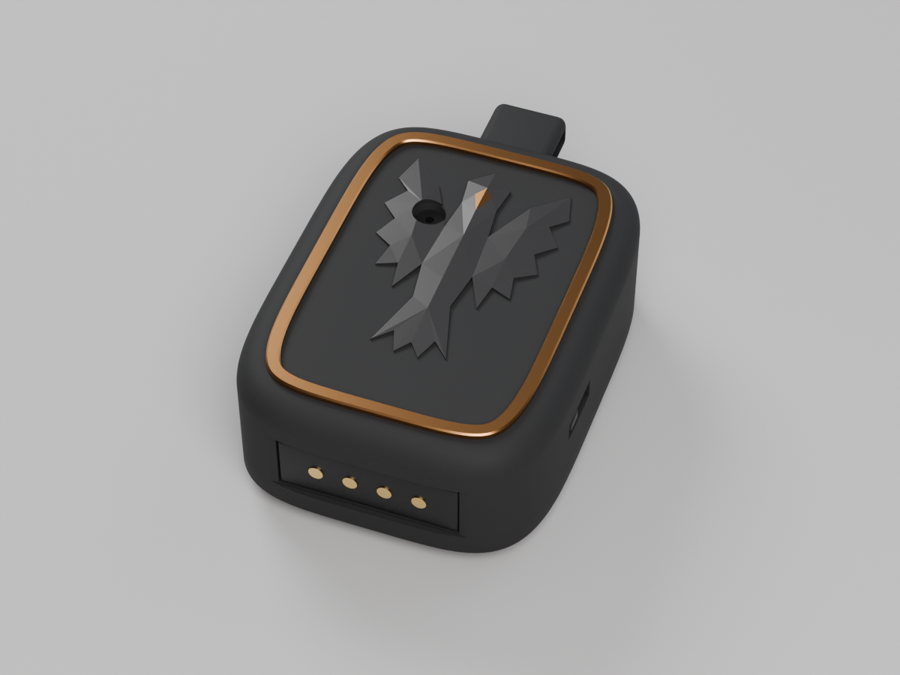

# 🦅 Eagle Capsule

**An open, private, always-on wearable memory recorder.** A ~36 g pebble worn
on a cord records your day. A nightstand dock charges it and records sleep audio
overnight. Everything syncs to **your own computer**: encrypted on the device,
transcribed locally, and searchable. No accounts, no vendor cloud.

> **Status: paper-validated, not yet built.** This repo is the complete pre-purchase
> dry run: parts checked against vendor pages, a numerical feasibility model, CAD,
> firmware architecture, a tested host-side sync pipeline against a simulated device,
> and concept renders. The physical build comes next.

> ⚠️ **Read [docs/LEGAL.md](docs/LEGAL.md) first.** Recording other people's private
> conversations without consent is an offence in every Australian state. In NSW even
> a party to the conversation needs everyone's consent unless a narrow exception
> applies, and it is untested whether a personal memory archive fits one.
> The design includes a firmware-enforced privacy switch (it cuts mic power) and a
> recording indicator for this reason.



## Verdict

**Viable. About A$165–180 in parts plus ~A$175 of one-off tools (debug probe, power analyser), no physical blockers.**

| Question | Answer | Source |
|---|---|---|
| Battery life (400 mAh) | **~108 h typical, ~39 h worst case** recording continuously; a 16 h day uses 15–41% of the battery | [`tools/feasibility.py`](tools/feasibility.py) |
| Overnight recharge | 0.7–2.1 h of an 8 h dock window at 100 mA, while still recording | same |
| Storage | 24 kbps Opus = ~260 MB/day; a 32 GB card is a ~80-day ring buffer (fixed 256 KiB slots, one per 60 s chunk, at any bitrate) | same |
| Sync | **Dock UART, ~0.8 h a night at 24 kbps (1.1 h at 32 kbps)**, is the main path. BLE at the 5 KB/s [Boswell](https://github.com/leakydata/boswell) measured on this board takes ~14 h at 24 kbps (19 h at 32 kbps); 1.8 h is an unmeasured fast-PC estimate. So BLE is the fallback on a dock with no UART host, plus on-demand pulls, not a continuous daytime link | same + [SYNC-PROTOCOL](docs/SYNC-PROTOCOL.md) |
| Size / weight | **37.4 × 49.7 × 18.6 mm** (+6.7 mm bail), **~36 g**, from the CAD. 15.4 mm thick without the USB-C service port, with a flatter back and a thinner bezel | [hardware/](hardware/README.md) |
| Better hardware? | The **Seeed reSpeaker Clip** (open firmware, nRF5340, Wi-Fi) is the best buy-and-customise option if you can get one; otherwise build this | [ALTERNATIVES](docs/ALTERNATIVES.md) |
| What could kill it | Measured current > 8 mA, or audio under a shirt too poor. Both are tested on the bench in the first two evenings, before printing anything | [BUILD-SIMULATION](docs/BUILD-SIMULATION.md) |

## Architecture

```
 ┌──────── capsule (worn / docked) ────────┐      ┌──── nightstand dock ────┐      ┌──────── your PC / home server ───────┐
 │ PDM mic → Opus 24 kbps → encrypt to     │ pogo │ 5V via Schottky → charge│ USB/ │ sync client → verify SHA-256 → ACK  │
 │ host public key → 60 s chunks → microSD │═════▶│ UART bridge to the PC   │ BLE  │ → decrypt → VAD → faster-whisper    │
 │ ring buffer. Privacy: firmware mic off  │      │ 30° cradle facing bed   │─────▶│ → SQLite FTS5 + daily Markdown      │
 │ XIAO nRF52840 Sense · 400 mAh LiPo      │      └─────────────────────────┘      └──────────────────────────────────────┘
 └─────────────────────────────────────────┘
```

## Repository map

| Path | What's there |
|---|---|
| [docs/BUILD-SIMULATION.md](docs/BUILD-SIMULATION.md) | **Start here.** The whole build, start to finish, on paper, with go/no-go gates and failure drills |
| [docs/ADVERSARIAL-REVIEW.md](docs/ADVERSARIAL-REVIEW.md) | Every claim in the original plan, checked: what held, what was wrong |
| [docs/ALTERNATIVES.md](docs/ALTERNATIVES.md) | Build vs buy; other boards; mic upgrades |
| [docs/WIRING.md](docs/WIRING.md) | Pin-by-pin wiring and diagrams |
| [docs/FIRMWARE.md](docs/FIRMWARE.md) | Zephyr/NCS firmware architecture, RAM/flash budget, test plan, milestones |
| [docs/SYNC-PROTOCOL.md](docs/SYNC-PROTOCOL.md) | Chunk format, list/fetch/ack sync, encryption at rest, time reconciliation |
| [docs/LEGAL.md](docs/LEGAL.md) | Australian recording law and the design rules that follow from it |
| [docs/MEMORY.md](docs/MEMORY.md) | The memory layer: every fact cites its audio, said / verified / committed / inferred, correction and deletion, false-memory guards |
| [tools/feasibility.py](tools/feasibility.py) | Power, charge, storage, sync, fit and weight model (`--worst` for the pessimistic case) |
| [host/](host/README.md) | Reference sync client plus a device simulator, with 40 passing tests (durability, filing, link security, bad-chunk and limit cases) |
| [hardware/](hardware/README.md) | Parametric OpenSCAD capsule and dock, self-checking fit asserts, print and assembly notes |
| [concepts/](concepts/README.md) | Blender concept renders (sized to the CAD) and the three eagle bezel directions |

## Quick start (no hardware needed)

```bash
python3 tools/feasibility.py            # typical case
python3 tools/feasibility.py --worst    # pessimistic case
cd host && python3 -m unittest -v       # sync pipeline against the simulated device
python3 hardware/check_cad.py           # every CAD variant: compiles, asserts hold, no interference (needs OpenSCAD)
```

## Credits

This project stands on **[BasedHardware/omi](https://github.com/BasedHardware/omi)**
(MIT), whose DevKits proved the XIAO nRF52840 Sense approach, plus hardware from
**Seeed Studio, Nordic, TI, Adafruit and Pololu**, parts supplied by **Core
Electronics**, and software from **Zephyr, Xiph Opus, Whisper/faster-whisper,
Silero VAD, bleak, OpenSCAD and Blender**. The initial plan came from a **Google
Gemini** conversation. It was independently checked and expanded by
**Anthropic's Claude** (Claude Code). Full list: **[CREDITS.md](CREDITS.md)**.

Not affiliated with or endorsed by any of the above. MIT licensed. See [LICENSE](LICENSE).
