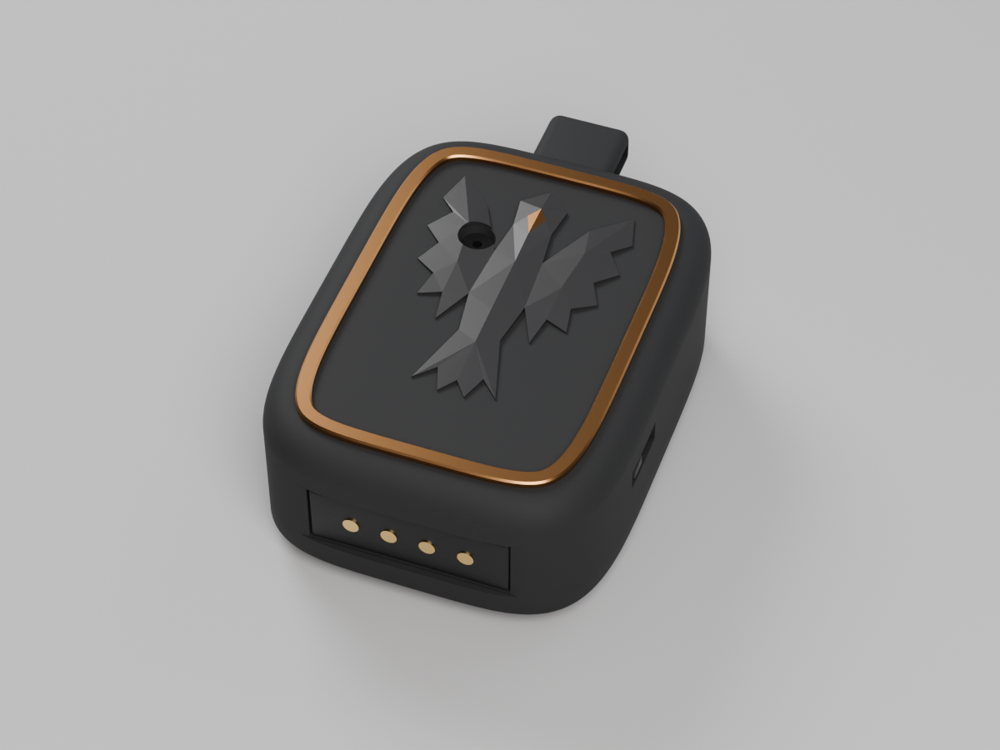
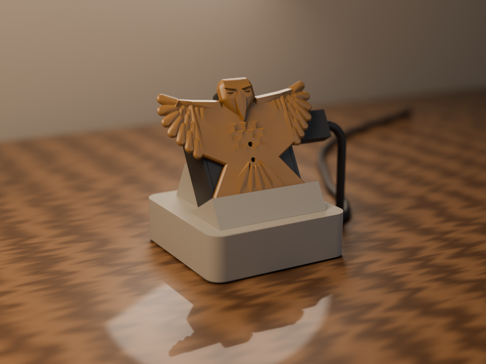
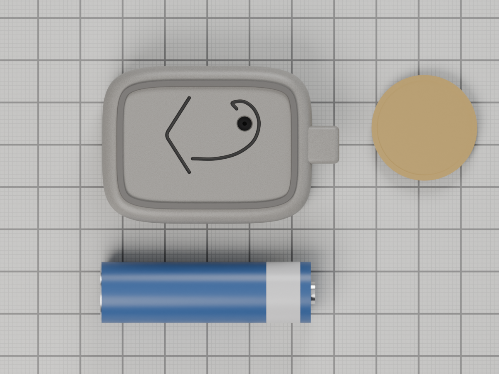
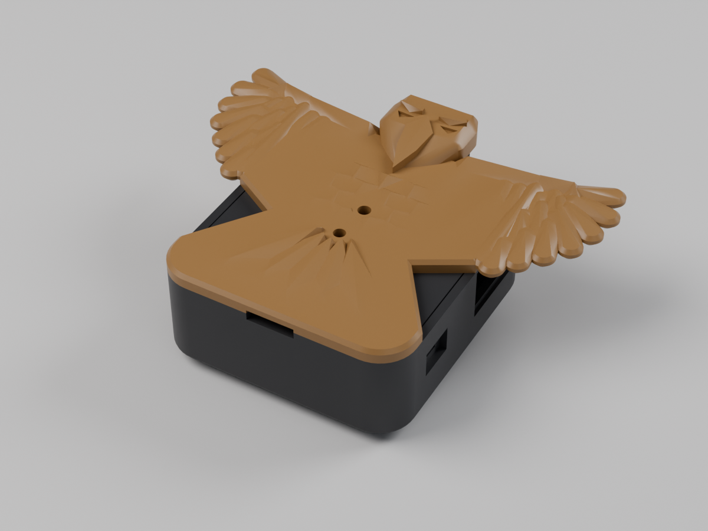

# Concepts

Renders for checking size and look before buying anything. Two kinds:

- **From the real CAD** (05 and 08): Blender imports the STLs that
  [`hardware/`](../hardware/README.md) renders, so these match what you print: the
  current default (600 mAh, IM73D122 mic board, USB-C side slot, eagle plate),
  core 41.4 × 44.3 × 18.35 mm.
- **Earlier hand-built concepts** (01–04, 06, 07): a Blender model of the first
  design (400 mAh, 37.4 × 49.7 × 18.6 mm, a magnetic pogo strip on the bottom edge).
  They still show the emblem options and the rough scale, but the pogo strip is gone
  (USB-C is now the only port) and the shape has changed a little.

All three eagle emblems are original designs and copy no existing logo or brand.

| | |
|---|---|
|  |  |
| **Low-poly.** Faceted spread-wing eagle in satin charcoal on a matte charcoal body, bronze bezel. Bold and graphic; the facets catch the light. The mic port is cleared through the left wing. | **Minimal.** One engraved line: an eagle head over a chevron of wings, on a satin stone-grey pebble. The mic port is the eagle's eye, so the one hole on the face looks like part of the mark. |
|  |  |
| **Crest.** A relief eagle with wings reaching into the bezel, dark green PETG with a brass-tone bezel. The most ornamental, and the hardest to print crisply at this size. | **Exploded.** Back shell with switch and bail, the 400 mAh pouch, the XIAO nRF52840 and microSD boards, the front shell with the mic foam well, the bezel, and the 4-pin pogo strip. |
|  |  |
| **Stand (CAD).** The printed stand from `dock.scad` on a nightstand with the CAD capsule and eagle plate: it leans back with its face toward the bed, and the USB-C cable plugs into the capsule's side. | **Scale.** Next to an AA cell (50.5 × 14.5 mm) and a 25 mm coin the size of an Australian $1, on a 10 mm grid. |
|  |  |
| **Scale, top-down.** Orthographic, 10 mm grid. The capsule is about as long as an AA and a bit wider than a $1 coin. | **CAD.** The printable body, lid and eagle plate exactly as `capsule.scad` outputs them (default variant), showing the USB-C slot and the switch and LED openings. |

## Honest take

- **Minimal reads best** at this size. One line and a hole that does a job. Low-poly is
  close behind and hides print lines well. Crest looks great in a render, but its fine
  feathers are near the limit of a 0.4 mm nozzle.
- **The size reads as "chunky", not "jewellery".** At 18.35 mm (current CAD) it is about as
  thick as a matchbox. The `slim` preset takes it to 16.75 mm. Decide
  after wearing a draft print for a day.

## Re-render

Blender 4.2 LTS, Cycles on the CPU (no GPU needed). The `dock` (stand) and `cad`
shots import STLs, so render those first:

```bash
mkdir -p hardware/build
for p in stand capsule_shell capsule_plate cable; do
  openscad -D "part=\"$p\"" -o hardware/build/$p.stl hardware/dock.scad
done
for p in body lid bezel; do
  openscad -D "part=\"$p\"" -o hardware/build/$p.stl hardware/capsule.scad
done
for s in lowpoly minimal crest exploded dock scale scale-top cad; do
  blender -b --factory-startup -P concepts/scripts/render_shot.py -- $s   # add --samples 24 --pct 50 for a quick preview
done
```

Output goes to `concepts/renders/`. Each shot takes 30–45 s on 16 cores at
1200 × 900 and 96 samples. Shared geometry, materials and studio helpers live in
`scripts/ec_common.py`. That file models the earlier concept; the CAD shots don't use its dimensions.

## Credits

Rendered with **Blender** (GPL-2.0+). The renders and scripts are this project's,
MIT licensed. The eagle emblems are original. The coin is a plain stand-in with no real coin artwork.
