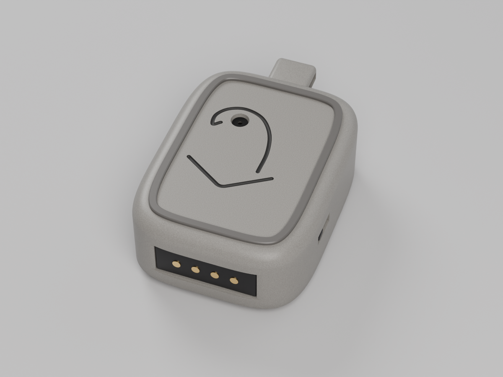
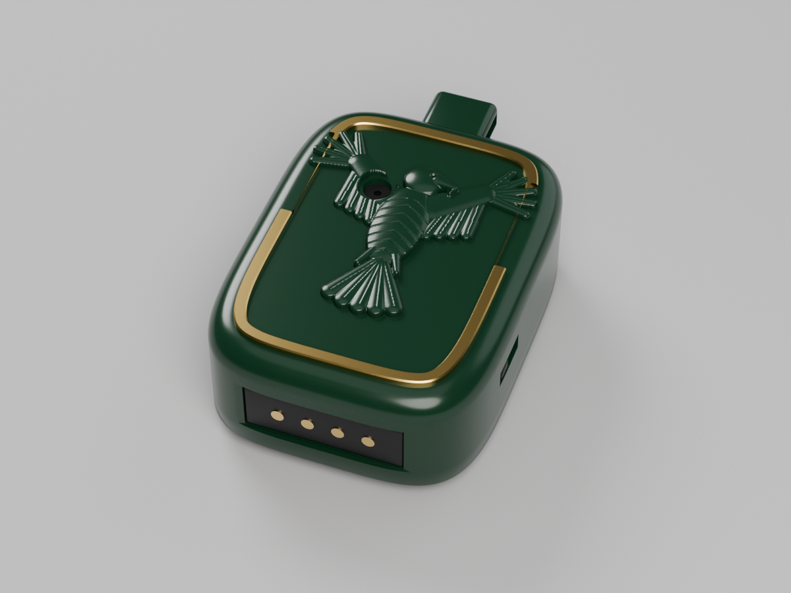
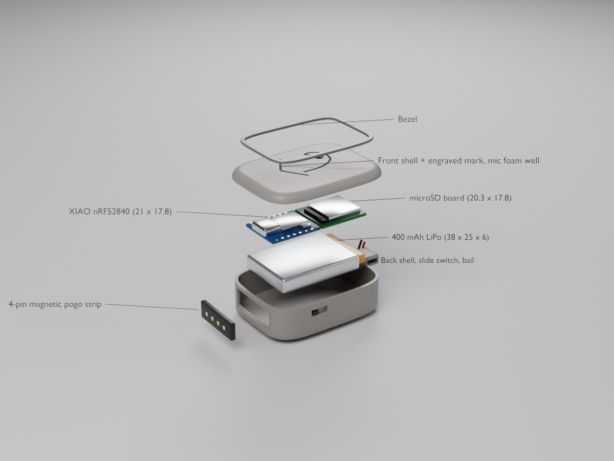
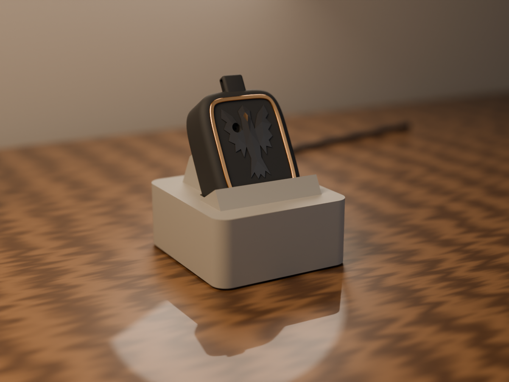
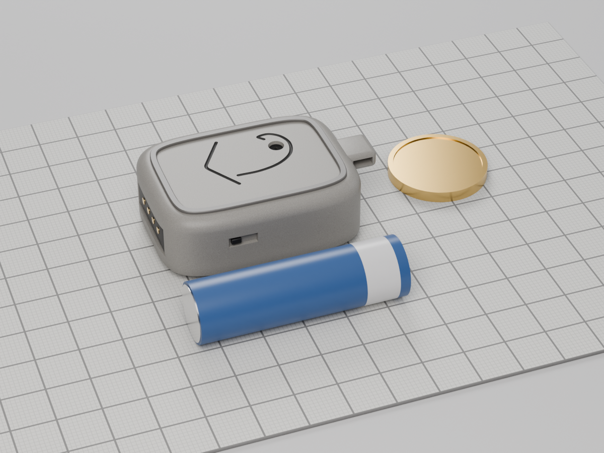

# Concepts

Concept renders for checking size and look before buying anything. The capsule
model is sized to the CAD in [`hardware/`](../hardware/README.md) (37.4 × 49.7 ×
18.6 mm). The mic port, the pogo strip and the switch are where the CAD puts them,
and the dock shot uses the real `dock.stl`. All three eagle emblems are original
designs and copy no existing logo or brand.

| | |
|---|---|
|  |  |
| **Low-poly.** Faceted spread-wing eagle in satin charcoal on a matte charcoal body, bronze bezel. Bold and graphic; the facets catch the light. The mic port is cleared through the left wing. | **Minimal.** One engraved line: an eagle head over a chevron of wings, on a satin stone-grey pebble. The mic port is the eagle's eye, so the one hole on the face looks like part of the mark. |
|  |  |
| **Crest.** A relief eagle with wings reaching into the bezel, dark green PETG with a brass-tone bezel. The most ornamental, and the hardest to print crisply at this size. | **Exploded.** Back shell with switch and bail, the 400 mAh pouch, the XIAO nRF52840 and microSD boards, the front shell with the mic foam well, the bezel, and the 4-pin pogo strip. |
|  |  |
| **Dock.** The OpenSCAD dock on a nightstand: the capsule leans back 30° with its face toward the bed, and the USB-C cable leaves from the back. | **Scale.** Next to an AA cell (50.5 × 14.5 mm) and a 25 mm coin the size of an Australian $1, on a 10 mm grid. |
|  | |
| **Scale, top-down.** Orthographic, 10 mm grid. The capsule is about as long as an AA and a bit wider than a $1 coin. | |

## Honest take

- **Minimal reads best** at this size. One line and a hole that does a job. Low-poly is
  close behind and hides print lines well. Crest looks great in a render, but its fine
  feathers are near the limit of a 0.4 mm nozzle.
- **The size reads as "chunky", not "jewellery".** At 18.6 mm it is about as thick as
  a matchbox. The slimming options in the hardware README take it to 15.4 mm. Decide
  after wearing a draft print for a day.

## Re-render

Blender 4.2 LTS, Cycles on the CPU (no GPU needed). The dock shot needs the dock STL first.

```bash
openscad -D 'part="dock"' -o hardware/build/dock.stl hardware/dock.scad
for s in lowpoly minimal crest exploded dock scale scale-top; do
  blender -b --factory-startup -P concepts/scripts/render_shot.py -- $s   # add --samples 24 --pct 50 for a quick preview
done
```

Output goes to `concepts/renders/`. Each shot takes 30–45 s on 16 cores at
1200 × 900 and 96 samples. Shared geometry, materials and studio helpers live in
`scripts/ec_common.py`. If the CAD changes size, update the dimension block at the top of that file.

## Credits

Rendered with **Blender** (GPL-2.0+). The renders and scripts are this project's,
MIT licensed. The eagle emblems are original. The coin is a plain stand-in with no real coin artwork.
